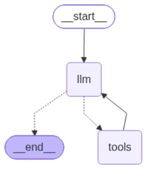

# Trip Planning Agent

## The Problem

Planning a trip means gathering travel information from multiple sources and organizing it into a practical itinerary before drafting it inside Google docs.

## The Solution

`trip_planner_agent.py` is an agentic AI travel assistant powered by Ollama and Gradio. It was built using LangGraph framework and the tools exposed to it allows it to search for attractions, flights, weather, public holidays, convert currencies, and export itineraries as Word documents. 


_Select "Graph view of Trip Planner Agent"_

## Running it

### Prerequisites

- Windows with Python and Ollama installed.
- Run `ollama pull <model-name>` to download the model locally or enable connection to free cloud models.
- API keys used Tavily, OpenWeatherMap, SerpApi, Frankfurter, Nager.Date.

### Set up

Open PowerShell in the project folder and create a virtual environment:

```powershell
py -m venv .venv
.\.venv\Scripts\Activate.ps1
python -m pip install requirements.txt
```

Set the values in `.env` beside `trip_planner_agent.py`:

```env
TAVILY_API_KEY = "xxx"
WEATHER_API_KEY = "xxx"
HOLIDAYS_API = "xxx"
SERPAPI_API_KEY = "xxx"
LLM_MODEL = "xxx"
LLM_MODEL_BASE_URL = "xxx"
```

### Run manually

From the project folder, with the virtual environment activated, run:

```powershell
python .\trip_planner_agent.py
```

Open the local Gradio URL printed in the terminal. Generated Word documents are saved in `agent_outputs` and can be downloaded from the user interface as well.
